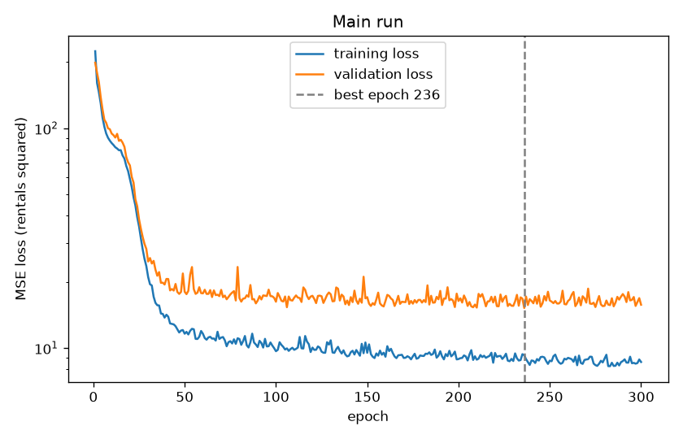

# Lakeshore Bike Demand

## What it does

Predicts how many bikes will be rented from a Lakeshore Bike Share station in the coming hour, from the hour of the day, the weather, whether it is a weekend and the type of station. A small PyTorch network, trained with a loop written by hand, is compared with two simple baselines on the same rows: predicting the training mean, and a linear regression.

## How to run it

```bash
conda env create -f environment.yml
conda activate lab07-first-principles

python train.py            # recreates everything in reports/ (about 15 seconds on a CPU)

python -m ruff format --check .
python -m ruff check .
python -m pytest
```

## Data and split

The data come from `bikes_data.py`, provided with the lab and never edited: 6,000 invented station-hours with seven columns, generated from a fixed seed so every run sees the same table.

- **Split first.** The rows are split 60% / 20% / 20% into training (3,600), validation (1,200) and test (1,200) with `random_state=42`, before any preparation.
- **Fit on training rows only.** The five numeric columns (`hour`, `temperature_c`, `rain_mm`, `wind_kph`, `is_weekend`) are standardized and `station_type` is one-hot encoded, giving 8 features. The scaler and the encoder are fitted on the training rows only and then applied to all three splits. If they were fitted on every row, the validation and test rows would leak into training and the scores would be too optimistic. A test checks this: the training features average exactly zero and the validation features do not.
- **Roles.** Training rows learn the weights. Validation rows choose the settings and the best epoch. Test rows are scored once, at the end.
- The target `rentals` is left as a raw count, so errors can be reported directly in rentals.

## Model and training

- **Network** (`model.py`): `Linear(8, 64) → ReLU → Linear(64, 64) → ReLU → Linear(64, 1)`. The last layer has no activation, because the target is a count, not a probability. The output is squeezed to shape `(batch,)` to match the targets.
- **Loss:** mean squared error (`nn.MSELoss`). The mean absolute error (MAE) in rentals is also logged, because it is easier to read.
- **Optimizer:** Adam, learning rate 0.003, for 300 epochs.
- **Batches:** a custom `Dataset` returns one row at a time as float32 tensors. The training `DataLoader` uses batches of 64 and shuffles. Validation and test loaders do not shuffle.
- **The loop** (`train.py`): `run_epoch` trains when given an optimizer (`zero_grad`, `backward`, `step`) and only measures otherwise. `train_model` logs the training loss, validation loss and validation MAE every epoch, and puts back the weights of the epoch with the lowest validation loss.
- **Seeds:** `torch.manual_seed(42)` before every run, and a seeded `torch.Generator` for the training DataLoader. Running `python train.py` twice gives an identical `reports/metrics.json` on the same computer. The last digits may differ on another computer.
- **How the settings were chosen:** learning rates of 0.001, 0.003 and 0.01 were compared on the validation rows, and 0.003 with 300 epochs gave the lowest validation loss. An earlier draft (learning rate 0.001, 100 epochs) printed a test score before this choice was made. That number played no part in the choice, which used validation loss only, but it is mentioned here for honesty.

## Results

Mean absolute error in rentals per station-hour. Lower is better.

| Model | Validation MAE | Test MAE |
|---|---|---|
| Predict the training mean | 10.15 | 9.65 |
| Linear regression | 9.32 | 8.57 |
| **Network (best epoch 236)** | **2.60** | **2.47** |

The network's predictions are off by about 2.5 bikes on average, against about 8.6 for the linear model.

**Why the linear model does poorly.** Plotting rentals against the hour shows that the pattern is not a straight line. On weekdays, rentals peak at the commute hours (about 29 at 8 am and 27 at 6 pm on average) and are low at midday (about 5 at 1 pm). On weekends the shape flips, with a single midday peak (about 20 at 1 pm). A linear regression gets one slope for `hour` and cannot bend to follow two peaks, let alone a shape that changes with the weekend. The effects of temperature, rain and wind also multiply rather than add. So the linear model is only slightly better than predicting the mean. The network's ReLU layers can bend, and they capture these patterns.



The curves show both losses falling steeply for the first 40 epochs and then flattening. Validation loss levels off at about 15 to 16 while training loss keeps easing down to about 9. The gap means the network fits the training rows a little more closely than new rows, but the validation loss does not turn upward, so it is not overfitting badly. The best epoch (236) is late and close to the plateau, so stopping there costs little.

## Experiments

Each run changes one setting from the main run. All runs last 300 epochs. Losses are MSE in rentals squared.

| Run | Change | Best epoch | Best val MAE | Final train loss | Final val loss |
|---|---|---|---|---|---|
| main | — | 236 | 2.60 | 8.6 | 15.7 |
| lr_too_small | learning rate 0.00001 | 300 | 9.18 | 163.1 | 190.5 |
| lr_too_large | learning rate 0.1 | 44 | 3.04 | 15.8 | 24.1 |
| too_wide | 512 hidden units | 26 | 2.56 | 3.7 | 21.2 |

The curves for every run are in `reports/curves_<run>.png`, and the full table is in `reports/experiments.csv`.

- **lr_too_small: underfitting.** Both losses are still high and still falling slowly at epoch 300, and the best epoch is the last one. The steps are too small to get anywhere in the time given.
- **lr_too_large: unstable.** The loss drops fast and then jumps up and down for the rest of training. The steps overshoot the bottom of the valley, so the network settles at a worse level than the main run.
- **too_wide: overfitting.** Training loss keeps falling to about 3.7, but validation loss is lowest at epoch 26 and then drifts upward to 21. The network has far more weights than 3,600 rows need, and starts memorizing them. Its best validation MAE (2.56) is close to the main run's, but only because the best weights were kept from epoch 26. The main run has the lower validation loss and does not depend on stopping at exactly the right epoch, so it is the network I chose.
- **main: fine.** Both curves flatten, and the gap between them stays steady rather than growing.

## Limitations

- **Invented data.** The table is simulated. It represents no real city, stations, riders or seasons, so the numbers say nothing about real demand.
- **What the model cannot see.** It knows nothing about events, holidays, the month or season, the number of bikes available at the station, or what happened in the previous hour. A concert or a closed station would surprise it.
- **Average error, not every hour.** An MAE of 2.5 is an average. Errors are larger at busy commute hours, where counts are high and noisy.
- **One split, one seed.** The scores come from one split and one random seed. A different split would move them a little.
- **What a planner should not use it for.** It gives an expected count, not a range, so it should not be the only basis for moving crews or bikes. It should not be used for stations or conditions outside the training data, such as temperatures below -15 °C or above 35 °C.
